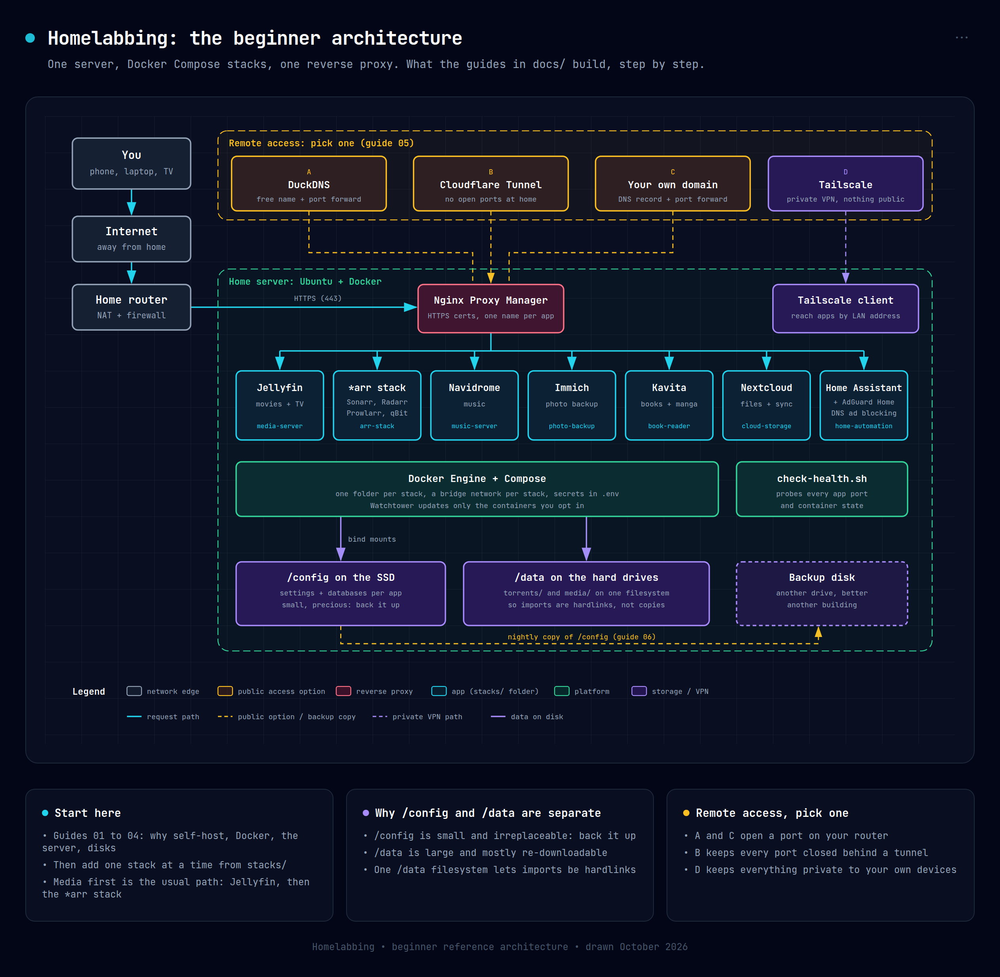

# Homelabbing

Welcome to **Homelabbing**: a practical, concept-driven guide to building, understanding and owning your digital life on your very first home server.

If you are tired of rising subscription fees, privacy-invading cloud services, or having your files locked inside someone else's servers, you are in the right place. Taking back control of your data should not need a computer science degree or mysterious automation scripts you do not understand.

Here, **you learn the architecture first, understand what every command does, and build your lab piece by piece.**

---

## What you will be able to build

Following the modular guides, you can turn an affordable refurbished PC into a private home cloud that replaces several subscription services:

| What you get | Commercial equivalent | The self-hosted stack |
| :--- | :--- | :--- |
| **Media streaming** | Netflix, Disney+ | [Jellyfin + *arr pipeline](stacks/media-server/) |
| **Music streaming** | Spotify, Apple Music | [Navidrome](stacks/music-server/) |
| **Photo backup and sync** | Google Photos, iCloud | [Immich](stacks/photo-backup/) |
| **Ebook and manga reader** | Kindle, ComiXology | [Kavita](stacks/book-reader/) |
| **Cloud storage and sync** | Google Drive, Dropbox | [Nextcloud](stacks/cloud-storage/) |
| **Smart home automation** | SmartThings, Apple Home | [Home Assistant](stacks/home-automation/) |
| **Network ad blocking** | AdGuard DNS Pro | [AdGuard Home](stacks/home-automation/) |

---

## Your learning path

The repository is structured so you can start from zero and grow into a confident server owner. Follow the foundational guides in order:

1. **[01. What is self-hosting?](docs/01-what-is-selfhosting.md)** The philosophy, the privacy benefits and the real cost compared with subscriptions.
2. **[02. Understanding Docker and containers](docs/02-understanding-docker.md)** How containers work, why we use `docker compose`, and how to manage services safely.
3. **[03. Your first home server](docs/03-your-first-server.md)** Pick hardware on any budget, install Ubuntu Server, set up SSH and install Docker Engine step by step.
4. **[04. Storage, disks and NAS concepts](docs/04-storage-and-nas.md)** Mounting disks, `lsblk`, `/etc/fstab`, and pooling drives with `mergerfs` into one `/data` pool.
5. **[05. Networking, DNS and reverse proxies](docs/05-networking-concepts.md)** Ports, DNS, TLS certificates, and safe remote access with DuckDNS, Cloudflare or Tailscale.
6. **[06. Backups and data redundancy](docs/06-backups-and-redundancy.md)** Separate configuration from bulk media, encrypt your snapshots, and survive a hardware failure.
7. **[07. Security and hardening basics](docs/07-security-basics.md)** UFW firewalls, network isolation, and never hardcoding secrets.
8. **[08. Home automation and ad blocking](docs/08-home-automation-and-ad-blocking.md)** Local smart home control with Home Assistant and network-wide DNS blocking with AdGuard Home.

---

## How this repository is organized

- **[`docs/`](docs/)**: concept guides that explain the *why* and *how* behind running a home server (`01` to `08`), plus [how the *arr pipeline fits together](docs/arr-stack-flow.md).
- **[`stacks/`](stacks/)**: modular, self-contained Docker Compose stacks (`media-server`, `arr-stack`, `music-server`, `photo-backup`, `book-reader`, `cloud-storage`, `home-automation`, `networking`, `full-stack`). Every line in every Compose file has a comment explaining what it does.
- **[`helpers/`](helpers/)**: diagnostic scripts such as `check-health.sh` to verify your setup.
- **[`reference/`](reference/)**: *for reading, not deploying.* A July 2026 snapshot of the author's own Compose files and recovery scripts, with READMEs that describe how the lab runs today: 55 containers in 16 stacks on one app server, plus a Proxmox host with 4 containers.

---

## The author's lab

The guide is the beginner version of a real two-server homelab. The **[My lab](https://Zamiul-rashid.github.io/Homelabbing/my-lab)** page on the website describes it: the hardware, what runs where, the media pipeline over NFS, monitoring and alerts, the nightly backup window, a timeline of changes, and the lessons learned, including what is still missing.

---

## The website and the community

Prefer browsing? The companion website has the same guides with an interactive networking wizard, per-service walkthroughs and a port reference:

**[Visit the Homelabbing website](https://Zamiul-rashid.github.io/Homelabbing/)**

Looking for more self-hosted apps? The Awesome-Homelab community directory lists hundreds:

**[Explore Awesome-Homelab](https://www.awesome-homelab.com/)**

---

## Philosophy: understand the architecture first, then build

Many repositories give you one "magic script" that hides what happens underneath. **Homelabbing** avoids that on purpose. When your server has a problem at 2:00 AM, a script you never understood will not help you fix it.

Learn how ports, container networks, volume bind mounts (`/config` vs `/data`) and reverse proxies work first. Once you understand the architecture, the implementation is straightforward, and you can troubleshoot on your own, customize with confidence, and truly own your infrastructure.
