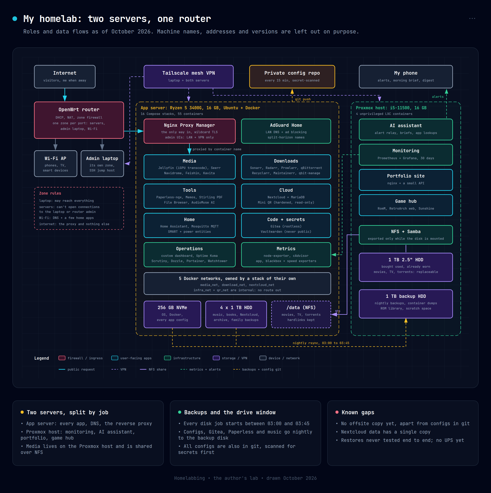

# The author's reference setup (`reference/`)

> [!IMPORTANT]
> **The files in this folder are a July 2026 snapshot. The text below describes the setup as it runs in October 2026.**
> The two have drifted apart. Where they disagree, this README says so. The snapshot is kept for reading, not for deploying.

Start with the modular stacks in [`stacks/`](../stacks/README.md) for your first server. Each one is small, commented line by line, and runs on its own. This folder is where you look later, when you want to see how the pieces fit together in a lab that has grown.

For the full write-up of the current lab, with diagrams, the backup schedule and a timeline, see the **[My lab](https://Zamiul-rashid.github.io/Homelabbing/my-lab)** page on the website.

The HTML sources for both diagrams are in [`diagrams/`](../diagrams/); open one in a browser and use its export menu to make a new PNG.

---

## What is in this folder

| Path | What it is | Snapshot vs today |
| :--- | :--- | :--- |
| [`media-stack/`](media-stack/README.md) | One 25-container Compose file from July: media, downloads, documents, smart home and dashboards in a single stack. | Today those services are split across 16 stacks with 55 containers. See [`media-stack/README.md`](media-stack/README.md). |
| [`nextcloud-stack/`](nextcloud-stack/) | Nextcloud and MariaDB. | Still a stack of its own. The MariaDB image is now pinned to a version. |
| [`proxy-stack/`](proxy-stack/) | Nginx Proxy Manager and a dynamic DNS updater. | Same idea today: the proxy is the only way in from the internet. |
| [`recovery/`](recovery/README.md) | Bootstrap, restore, backup and start-up scripts. | The backup has changed a lot. See [`recovery/README.md`](recovery/README.md). |

---

## The lab in October 2026, in one page

### Two servers and a router

- **The app server** runs every user-facing app in Docker, plus LAN DNS, the reverse proxy and most of the bulk storage. AMD Ryzen 5 3400G (its Vega iGPU does Jellyfin transcoding), 16 GB RAM, a 256 GB NVMe for the OS and all configs, and four 1 TB hard disks. Ubuntu LTS.
- **The Proxmox host** is the hypervisor, the backup disk, the NFS server for media and a Samba share. Intel i5-11500, 16 GB RAM, a 256 GB NVMe for guest disks, a 1 TB disk for backups and a used 1 TB 2.5" disk for movies, TV and torrents.
- **The router** runs OpenWrt and gives each physical port its own firewall zone (servers, admin laptop, Wi-Fi). The old router is now just a Wi-Fi access point.

### 55 containers in 16 Compose stacks

| Group | Stacks |
| :--- | :--- |
| Media | `media` (Jellyfin, Seerr, Navidrome, Feishin, Kavita), `download` (qBittorrent, Sonarr, Radarr, Prowlarr, qbit-manage, Recyclarr, Maintainerr) |
| Documents and personal data | `tools` (Paperless-ngx with Redis, File Browser, Memos, Stirling PDF, AudioMuse AI with Postgres and pgvector), `nextcloud`, `vault` (Vaultwarden, LAN and Tailscale only), `dev` (Gitea) |
| Home | `smarthome` (Home Assistant, Mosquitto, AdGuard Home) |
| Edge and plumbing | `proxy` (Nginx Proxy Manager, dynamic DNS), `networks` (owns the shared Docker networks), `qr` (Mini QR, hardened) |
| Monitoring | `infra` (a hand-written dashboard, Portainer, Dozzle, GoAccess, Scrutiny, Uptime Kuma, docker-socket-proxy, Watchtower), `monitoring`, `network-monitoring`, `app-exporters` |
| Kept but stopped | an old Prometheus and Grafana stack; the live copies moved to the Proxmox host |

The Proxmox host runs four unprivileged LXC containers: monitoring (Prometheus and Grafana), a self-hosted AI assistant that relays alerts to my phone, a portfolio site, and a game hub.

### What changed since the snapshot

- **Homarr, Homepage and Actual Budget are gone.** A small hand-written dashboard replaced both dashboards; its numbers come live from Prometheus.
- **Seerr replaced Jellyseerr.** It is the same request app under its new name and image.
- **Watchtower is opt-in.** It runs once a day and only updates containers that are labelled for it. Pinned images (qBittorrent, qbit-manage, Nextcloud's MariaDB) are excluded. Watchtower does not use Redis; Redis is there for Paperless-ngx.
- **Alerts go to my phone through Grafana**, not through Uptime Kuma. Grafana sends a webhook to the AI assistant's relay, which forwards it to my phone with no language model in the path. Uptime Kuma still runs, with 38 monitors.
- **There is no VPN container.** Earlier text mentioned routing downloads through `gluetun`. That was hypothetical; it was never deployed.
- **Downloads live in `/data/torrents`**, not `/data/downloads`. qBittorrent downloads into `/data/torrents/incomplete` and moves finished files to `/data/torrents/radarr` or `/data/torrents/sonarr`. Since 1 October 2026, `/data` on the app server is an NFS share from the Proxmox host.
- **Five Docker networks instead of three**, all owned by a dedicated `networks` stack (see below).
- **Paths moved** from `/opt/homelab` to `~/homelab`, and that folder is now a Git repository that syncs itself every 15 minutes (see [`recovery/README.md`](recovery/README.md)).

---

## Why the networks are split

The July snapshot defines three networks at the bottom of [`media-stack/docker-compose.yml`](media-stack/docker-compose.yml). Today there are five:

| Network | Who is on it | Notes |
| :--- | :--- | :--- |
| `media_net` | Front-end apps | Apps that people open in a browser or a TV app. |
| `download_net` | Sonarr, Radarr, Prowlarr, qBittorrent and their exporters | Keeps the download side apart from the apps people use. |
| `infra_net` | Redis, the AudioMuse database | `internal: true`. Nextcloud, Paperless and AudioMuse are on it **and** on a front-end network, so only they can reach the databases. |
| `nextcloud_net` | Nextcloud and MariaDB | |
| `qr_net` | Mini QR and the proxy | `internal: true`. Nothing else can reach Mini QR. |

### `internal: true` in one paragraph

A Docker network with `internal: true` has no route to the outside world. Containers on it cannot reach the internet, and nothing outside can reach them through it. Put a database on an internal network, give it no published ports, and the only way to talk to it is from another container that you deliberately attached to the same network.

### Why a separate `networks` stack?

If a network is defined inside an app's Compose file, `docker compose down` on that app deletes the network, even when other stacks still use it. In this lab a tiny "network keeper" container owns all five networks, and every app stack joins them as `external: true`. Taking any app stack down can no longer break the others.

---

## Why keep this folder?

The beginner stacks in `stacks/` teach one service at a time. A grown lab shows things the beginner stacks cannot:

1. **How many services share networks and storage.** Read [`media-stack/docker-compose.yml`](media-stack/docker-compose.yml) to see 25 containers, three networks and the `/data` layout in one file. It is also a good example of why the lab was later split into smaller stacks.
2. **Database isolation.** Look for `internal: true` on `infra_net`.
3. **Encrypted backups.** [`recovery/03-backup.sh`](recovery/03-backup.sh) pauses the proxy while it archives, then encrypts the tarball with OpenSSL (AES-256-CBC with PBKDF2).

Take the patterns that fit your own lab and leave the rest.
